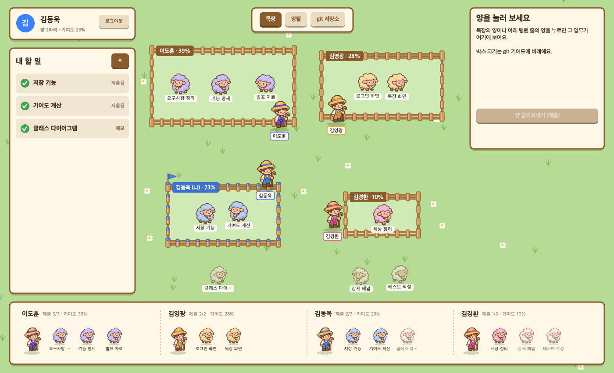

# 잔디 (Jandi)

기여도가 보이는 대학생 팀 프로젝트 협업 프로그램입니다.
Java Swing으로 만든 데스크톱 프로그램이며, 2026 소프트웨어시스템설계 팀 프로젝트(Team 3)의 로컬 버전입니다.



## 주요 기능

| 기능 | 설명 |
|---|---|
| 로그인 | 팀원 4명(이도훈·김영광·김동욱·김경환) 중 이름을 골라 들어갑니다. 비밀번호는 다음 단계에서 넣습니다. |
| 내 할 일 | 할 일 추가(+), 완료 체크, 메모, 삭제 |
| 제출 | 완료한 할 일을 제출하면 양이 내 박스 안으로 들어갑니다. |
| 내보내기 | 박스 안의 내 양을 누르고 "양 내보내기"를 누르면 제출을 취소하고 완료 상태로 되돌립니다. |
| 목장 | 팀원마다 박스가 하나씩 있고, **박스 크기는 git 기여도에 비례**합니다. 박스 위에 이름과 기여도 %가 적힙니다. 다른 팀원의 양도 눌러서 내용을 볼 수 있습니다. |
| 움직임 | 농부는 자기 박스의 가운데 쪽 모서리 근처를 걸어 다니고, 양은 제자리 근처에서 걷고 풀을 뜯습니다. 농부 옷과 양털은 팀원 색으로 칠해집니다. |
| 양털(잔디밭) | 팀원별로 날짜마다 커밋 수를 색의 진하기로 보여 줍니다. |
| git 저장소 | 로컬 git 폴더를 연결하고 팀원과 git 작성자를 짝짓습니다. 네트워크는 쓰지 않습니다. |

### 기여도 계산

팀이 함께 쓰는 로컬 git 저장소 하나를 `git log`로 읽습니다. 커밋마다 작성자가 기록되어 있으므로 저장소는 하나면 됩니다.

    기여도(%) = (내 커밋 수 비율 + 내 변경 줄 수 비율) ÷ 2

병합 커밋과, 팀원과 짝지어지지 않은 작성자의 커밋은 세지 않습니다.

## 실행

JDK 17 이상과 git이 필요합니다.

```bash
java -jar build/dist/jandi.jar
```

처음 실행하면 **샘플로 시작**할지 **빈 상태로 시작**할지 묻습니다. 샘플은 할 일 11개와, 팀원 4명의 커밋이 든 예시 git 저장소를 만듭니다.

| 인자 | 설명 |
|---|---|
| `--data <폴더>` | 데이터 폴더 (기본: `~/jandi-data`) |
| `--repo <폴더>` | 기여도를 읽을 로컬 git 폴더 |
| `--sample` | 처음 실행이면 묻지 않고 샘플을 넣습니다. |

## 빌드

```bash
./build.sh
```

Windows에서는 Git Bash에서 실행합니다. 잔디가 실행 중이면 jar 파일이 잠겨 빌드가 멈추므로, 먼저 끄고 빌드하세요.

1. 컴파일 (`build/classes`)
2. 자체 테스트 `jandi.SelfTest` 11개 실행 (외부 라이브러리 없음)
3. 실행 jar `build/dist/jandi.jar`
4. API 문서 `build/javadoc/index.html`

## 구조

```
src/main/java/jandi
├── App.java        시작점
├── domain/         Member, Task, TaskStatus, Commit, Contribution
├── service/        Ranch(연결), TaskService, GitService, ContributionService, JandiException
├── store/          DataStore(CSV 저장·로그), Csv, SampleData
└── ui/             MainFrame, LoginDialog, RanchPanel, GrassPanel, TaskListPanel,
                    DetailPanel, TeamStrip, RepoDialog, Sprites, UiKit
src/main/resources/jandi farmer.png, sheep.png (스프라이트 시트: 동작 4줄 × 4칸)
src/test/java/jandi SelfTest(자체 테스트), ScreenshotTour(화면 캡처)
```

## 알려진 한계

- 한 컴퓨터에서만 동작합니다. 네트워크와 GitHub 연동은 다음 단계입니다.
- 로그인에 비밀번호가 없습니다.
- 할 일 제출은 git 커밋과 연결되지 않습니다(메모만 적어 제출).
